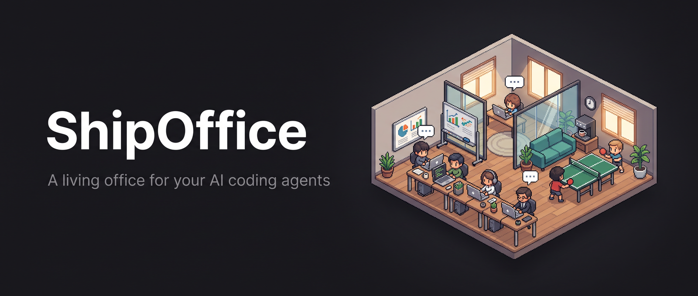
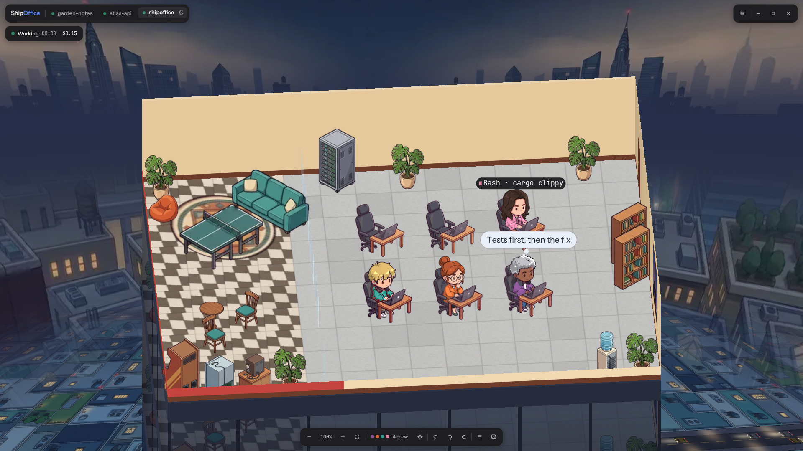
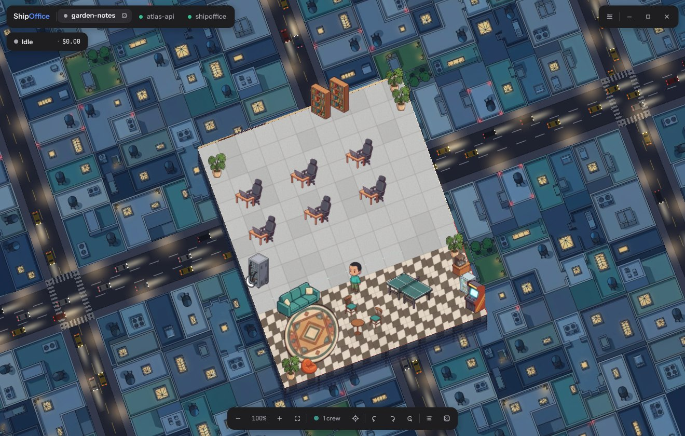

<p align="center">
  
</p>

<h3 align="center">Your agents deserve an office.</h3>

<p align="center">
  ShipOffice turns every AI coding session on your machine into a tiny living office.<br>
  The lead takes a desk, subagents walk in to help, and you watch the work happen.
</p>

<p align="center">
  <a href="https://github.com/secblitz/ShipOffice/releases/latest"></a>
  <a href="https://github.com/secblitz/ShipOffice/actions/workflows/ci.yml"></a>
  
  
</p>

<p align="center">
  <a href="docs/demo.mp4"></a>
  <br><sub>▶ <a href="docs/demo.mp4">Watch the 37-second demo (1080p, 60 fps)</a></sub>
</p>

---

## Give them somewhere to work

Coding agents spend hours in a terminal you can only scroll. ShipOffice gives each of them a place.

Start Claude Code, Codex or any other harness in a project, and a new office opens in a tab. Your lead agent sits down at a desk. When it hands work to a subagent, a new colleague walks in, takes the next free desk and leaves when the task is done. Everyone types, reads, thinks or waits exactly as their agent does, with a bubble showing the tool they are using and what they last said. When an agent is waiting on you, a thought bubble says so.

It is a window you can leave open on a second screen and glance at, instead of a log you have to read.

## Works with the tools you already use

ShipOffice finds your sessions on its own. There is nothing to install in your harness, no hooks, no plugin and no API key.

| | | |
|---|---|---|
| **Claude Code** | **Codex** | **OpenCode** |
| **Gemini CLI** | **Qwen Code** | **GitHub Copilot CLI** |
| **Cursor** | **Cline** | **Roo Code** |
| **Kilo Code** | **Goose** | **Crush** |
| **Factory Droid** | **Aider** | **Amp** |

Each one is read from the session files it already writes; [docs/harnesses.md](docs/harnesses.md) explains where and how.

## Features

- **An office per session.** Every project gets its own procedural floor plan, with desks, a lounge, a coffee bar, ping pong and a whiteboard of live stats. Don't like it? Roll a new one from the dice on its tab.
- **A crew that behaves like your agents.** Subagents arrive, work and leave. Idle agents grab a coffee, play ping pong or sit on the couch. Seven characters take turns, each in the clothes it was drawn in, and every agent stands on a ring of its own colour.
- **It tells you when it needs you.** An agent waiting on a permission prompt or your answer raises its hand and says what it is asking, the crew bar counts who is waiting (one click goes to the next), and a desktop notification reaches you while ShipOffice is in the background.
- **Trouble shows at a glance.** An agent that should be working but has done nothing for a while slumps at its desk with z's over its head, and a failed tool call puffs red. Tool bubbles grow as you zoom, are cut between words, never pile up on each other, and in a big crew only the ones that matter show: whoever waits on you, just failed, leads, or is under your pointer.
- **Teams sit together.** Helpers started together, such as one phase of a workflow, take neighbouring desks and meet at the whiteboard when their phase is done, so a crowd of hundreds reads as teams.
- **Find anyone.** The crew list searches by name, task or team, filters to who needs you, who is stuck, who failed and who is near compaction, and takes you to whoever you pick. Big floors get a minimap you can click to look around.
- **Replay the last hour.** Play back what a session did, up to 64 times as fast, and scrub to any moment to see what each helper was up to.
- **Bring your own crew.** Add your own characters with their own animations, give the built-in crew new ones, or swap any prop for your own art, each with a switch in settings. See [docs/custom.md](docs/custom.md).
- **Look from anywhere.** Pan, turn, tilt and zoom freely. The room is real geometry and the furniture faces the right way from every side, so it holds up at any angle.
- **A floor of a skyscraper.** Your office sits high above New York by day or by night, with the skyline, the floors below yours, and traffic in the streets.
- **Know what each agent knows.** The ring under each agent fills as its context fills, turning red near compaction, and when its context is compacted it tidies its desk. Click anyone to see their tokens, tool calls and how full their context is, against the window it really has: the one the harness logs, the one you set (Claude Code's `autoCompactWindow`, per model or for all), or the model's own, never less than what it has already carried. The gauge marks the compaction point you set and counts every compaction, read from the log or, for harnesses that don't write them down, from the context suddenly shrinking.
- **Room for a crowd.** Run a few agents or a few hundred: the office grows with the crew, adding rows of desks and a longer lounge, up to 512 desks, and the camera zooms in further on a big floor. Newcomers stream in faster when many arrive at once.
- **Every session at a glance.** Tabs for your live sessions, cost and timing on the whiteboard, and a live feed of everything that happens.
- **Show how locked in you are.** The ⚡ Locked in button turns what your agents are doing right now into a card for your feed: a score out of 100, the office itself, the crew's faces, tool calls, tokens and how long you have been at it. Save it as a PNG and copy a caption to post with it.
- **Make it yours.** Themes, accent colours, office styles, the city backdrop or none, all from a settings menu.
- **Private by design.** ShipOffice only reads the logs on your disk. It never writes to them, never opens credential files and never sends anything over the network.

<p align="center">
  
</p>

## Get it

### Download a release

Grab the latest build for your platform from [Releases](https://github.com/secblitz/ShipOffice/releases/latest), unpack it and run `shipoffice`. It is a single binary with all of its art inside.

- **Linux:** `shipoffice-linux-x86_64.tar.gz`
- **Windows:** `shipoffice-windows-x86_64.zip`

Every build comes with a `SHA256SUMS.txt` so you can check what you downloaded.

### Build from source

You need **Rust 1.85 or newer** ([rustup.rs](https://rustup.rs)) and a graphics driver with Vulkan, Metal, DirectX 12 or OpenGL.

| Platform | Also needed |
|---|---|
| Linux | A C compiler (`gcc` or `clang`). No `-dev` packages: windowing and graphics libraries are loaded at runtime. |
| macOS | Xcode Command Line Tools: `xcode-select --install` |
| Windows | Visual Studio Build Tools with the "Desktop development with C++" workload |

```sh
git clone https://github.com/secblitz/ShipOffice.git
cd ShipOffice
cargo build --release
./target/release/shipoffice
```

To install it on your `PATH` instead, run `cargo install --path .`. Run the tests with `cargo test --release`.

## Using it

Run `shipoffice` and start an agent anywhere. With nothing running yet, a demo crew keeps the office busy so you can look around.

| Input | Does |
|---|---|
| Drag | Pan |
| Right-drag, or Shift + drag | Turn and tilt |
| Scroll | Zoom |
| Q / E | Turn a quarter |
| R | Back to the classic angle |
| N | A new office for this session |
| L | Make a Locked in card to share |
| Click someone | Inspect them |
| F | Follow the selected agent |
| Tab | Next agent |
| Esc | Back to live from a replay |
| 1 to 9 | Switch tabs |

Settings are saved to a TOML file you can also edit by hand: `~/.config/shipoffice/config.toml` on Linux, `~/Library/Application Support/dev.shipoffice.ShipOffice/config.toml` on macOS and `%APPDATA%\shipoffice\ShipOffice\config\config.toml` on Windows. Set `SHIPOFFICE_CONFIG` to use another file.

## License

ShipOffice is source-available under the [PolyForm Noncommercial License 1.0.0](LICENSE.md).

You are welcome to use it, study it, change it and share it for any noncommercial purpose, as long as you keep the license and its `Required Notice:` line crediting the project. Selling it, or shipping it as part of a commercial product or service, needs written permission.
